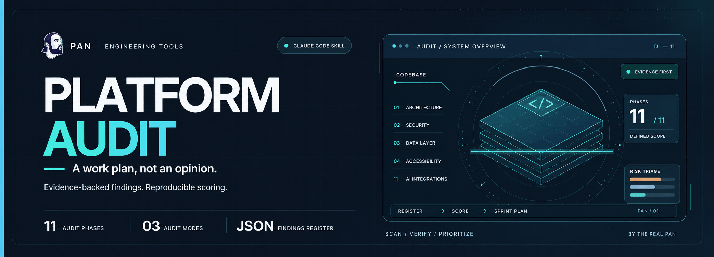

# pan-platform-audit



[English](README.md) | Italiano | [Français](README.fr.md)

Una skill per Claude Code che esegue l'audit di un intero codice sorgente e restituisce un piano di lavoro, non un parere. Lancia comandi reali in 11 fasi, apre ogni risultato prima di contarlo e calcola il punteggio di salute dal registro dei finding con uno script: due audit dello stesso codice danno lo stesso numero.

## Cosa copre

Ricognizione, poi architettura e dipendenze, sicurezza e supply chain, codice morto, dati, prestazioni, SEO e reperibilità da parte dei sistemi AI, osservabilità, test, UX e accessibilità, privacy e protezione dei dati, integrazioni AI e LLM (con una prima classificazione secondo l'AI Act europeo, che non è un parere legale).

Tre modalità: `full` (tutte le fasi), `lite` (un controllo rapido prima del rilascio) e `re-audit` (riverifica un registro precedente e mostra l'andamento del punteggio).

## Cosa si ottiene

Un rapporto in Markdown, generato da un registro dei finding in JSON, con sintesi per la direzione, registro dei finding (ID, evidenza, rimedio, stima in ore, criterio di accettazione), matrice delle priorità, piano su tre sprint, registro dei rischi per i finding S0 e S1, e un registro dell'audit che rende riproducibile quello successivo.

## Installazione

Copia la cartella nella directory delle skill:

```bash
git clone https://github.com/therealpan/pan-platform-audit ~/.claude/skills/pan-platform-audit
```

Poi chiedi a Claude Code "un audit della piattaforma" dentro un repository. Prima di partire la skill chiede dove sta il codice, un eventuale URL in esecuzione, la modalità e le aree su cui concentrarsi.

Il rapporto è scritto nella lingua in cui chiedi l'audit.

## Punteggio

Il registro dei finding è un file JSON accanto al rapporto (schema in `register.schema.json`, esempio in `examples/register.example.json`). `scripts/audit_score.py` lo valida, calcola il punteggio e scrive nel rapporto due blocchi generati: la sintesi e la tabella del registro. Il rapporto non viene mai interpretato, quindi un errore di formattazione non può nascondere un finding. Serve Python 3.9 o successivo, solo libreria standard; con `--lang it` scrive in italiano e accetta le opzioni in italiano.

Il punteggio non può nascondere un rischio. Un S0 aperto lo limita a 3,9, un S1 aperto a 7,9. Le fasi non applicabili richiedono una motivazione scritta, stampata con il punteggio; quelle che si applicano ma non sono state eseguite si dichiarano nel registro e abbassano la copertura; con copertura sotto il 100% il punteggio non supera 7,9, con la sicurezza non verificata 5,9, e dichiarare una fase non verificata non può mai alzarlo. "Livello produzione" richiede quindi copertura piena e nessun S0 o S1 aperto. Se la fase AI si applica va dichiarato, non si deduce dai finding.

```bash
python3 scripts/audit_score.py registro.json --lang it                                  # stampa la sintesi
python3 scripts/audit_score.py registro.json --lang it --rapporto rapporto.md --scrivi  # scrive i blocchi fra i marcatori
python3 scripts/audit_score.py registro.json --lang it --rapporto rapporto.md --verifica  # esce con 1 se il rapporto non è aggiornato
python3 scripts/audit_score.py registro.json --lang it --soglia 6,0                     # esce con 2 sotto la soglia, utile in CI
python3 -m unittest discover -s tests                                                   # lancia i test
```

Il rapporto deve contenere i marcatori `<!-- score:start -->` / `<!-- score:end -->` e `<!-- register:start -->` / `<!-- register:end -->`. Un registro non valido (chiavi sconosciute, severità o stato non ammessi, ID malformato o ripetuto, finding fuori dal perimetro dichiarato) ferma lo script con codice 1 e l'elenco dei problemi; con `--scrivi` quell'elenco sostituisce il blocco del punteggio.

## Limiti

La skill ispeziona e documenta, non corregge il codice. Nelle fasi su privacy e AI segnala le questioni da sottoporre a un legale e non dà conclusioni giuridiche. Se uno scanner non si installa, la fase si controlla a mano e il rapporto lo dichiara.

## Licenza

MIT. Made by Pan.
